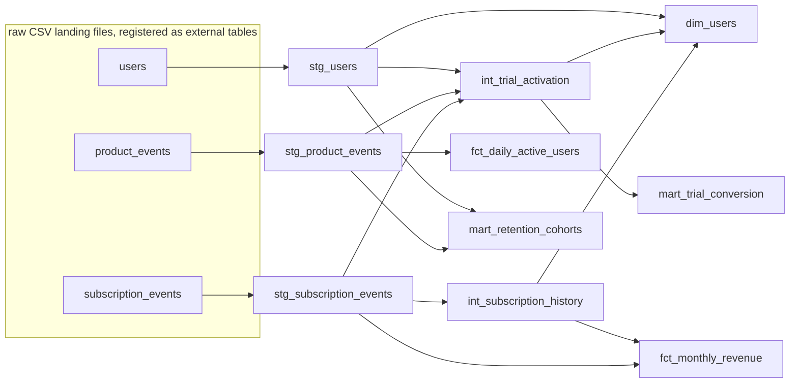

# Subscription Analytics Pipeline (dbt on Spark + Delta Lake)

A dbt Core project that turns raw SaaS exports (signups, subscription events and product events)
into tested Delta Lake tables: daily active users, month-end MRR, retention cohorts and
trial-to-paid conversion. It runs on Apache Spark with Delta Lake, the engine underneath Databricks,
which dbt-spark starts in-process. Cloning the repo and running `dbt build` needs Java 17 and
Python, with no cluster or account.

The source data is synthetic, generated by a seeded script that deliberately injects the problems
a real pipeline has to handle: duplicate events, late-arriving events, and a UTC/IST time-zone split.

## Lineage



| Layer | Materialization | Models |
|---|---|---|
| Staging | view | `stg_users`, `stg_subscription_events`, `stg_product_events` |
| Intermediate | view | `int_subscription_history` (Type 2), `int_trial_activation` |
| Marts | Delta table / incremental Delta MERGE | `dim_users`, `fct_daily_active_users` (incremental), `fct_monthly_revenue`, `mart_retention_cohorts`, `mart_trial_conversion` |

## Run it

Needs Python 3.12 and Java 17 (on macOS: `brew install openjdk@17`, then
`export JAVA_HOME=/opt/homebrew/opt/openjdk@17`).

```bash
python -m venv .venv && source .venv/bin/activate
pip install -r requirements.txt
python scripts/generate_data.py
dbt build --profiles-dir .
```

The first run downloads the Delta Lake jar from Maven Central. Run `dbt build` a second time to
exercise the incremental MERGE. CI runs both builds on every push.

## What a run produces

From the seeded dataset (`SEED = 42`):

| Check | Result |
|---|---|
| Raw product events | 297,999 rows, 295,049 distinct after deduplication (2,950 re-sends removed) |
| Late-arriving events (ingested over a day after they happened) | 8,936 |
| Signups on a different calendar day in IST than in UTC | 1,152 of 5,000 (23.0%) |
| Trial conversion, activated vs not activated | 32.8% vs 13.1% |
| Models / data tests | 10 models, 42 tests, all passing on both full and incremental runs |

The project was first built on DuckDB and then ported to Spark. Every metric above and every
table's row count came out identical on both engines.

## Design decisions

**Report in IST, store in UTC.** Raw timestamps stay in UTC; every reporting date, week and month is
computed in IST through the `to_ist` and `ist_week_start` macros. IST has no daylight saving, so a
fixed +5:30 offset is exact. Bucketing by UTC date would put 23% of signups on the wrong day.
`assert_late_utc_signups_roll_to_next_ist_day` re-derives the expected IST date independently and
fails if that bug comes back.

**Pin Spark's session time zone.** Spark parses timestamp strings in the session time zone, which
defaults to the machine's. On a machine set to IST every raw event would silently shift by 5.5
hours, so the profile sets `spark.sql.session.timeZone` to UTC.

**Deduplicate in staging.** Clients re-send some events with the same `event_id`.
`stg_product_events` keeps the first ingested copy with `row_number()`, and a `unique` test on
`event_id` proves it.

**Incremental MERGE with a lookback, proved by reconciliation.** `fct_daily_active_users` is an
incremental Delta table merged on the date key. Each run recomputes the last `late_arrival_days`
(default 3) days already in the table and MERGEs them in, so late events still land on the day they
happened. `assert_daily_active_users_reconcile_to_staging` compares the incremental table with a
full recompute, day by day, and fails on any mismatch.

**Type 2 history from an event log.** `int_subscription_history` derives one row per subscription
state with `LEAD()`, giving `valid_from` / `valid_to` windows. The custom `no_overlapping_windows`
test and `assert_one_current_version_per_user` keep the history consistent, and
`fct_monthly_revenue` reads month-end MRR from it.

**Explicit raw schemas.** `register_raw_tables` exposes the landing CSVs as external tables with
declared column types, so nothing depends on schema inference.

**Portable SQL.** Date logic goes through dbt's cross-database macros (`dateadd`, `datediff`,
`date_trunc`, `date_spine`, `hash`). Time windows are added in hours, because a day-based `dateadd`
returns a date on Spark and would drop the time of day.

## Running on Databricks

Not tested. `profiles.yml` has a `databricks` target that reads `DATABRICKS_HOST`,
`DATABRICKS_HTTP_PATH` and `DATABRICKS_TOKEN`. Running it would need `pip install dbt-databricks`,
the three raw tables loaded into a `raw` schema (the CSV registration hook only runs on the local
Spark target), and `dbt build --profiles-dir . --target databricks`. The models already write Delta
tables and use MERGE, which is how Databricks runs them natively.

## Layout

```
scripts/generate_data.py   seeded synthetic data with injected duplicates, late events and the UTC/IST split
models/staging/            sources, light cleaning, deduplication, IST dates
models/intermediate/       Type 2 subscription history, trial activation
models/marts/              dimensions, facts and cohort marts (Delta)
macros/                    to_ist, ist_week_start, register_raw_tables
tests/generic/             not_negative, unique_combination, no_overlapping_windows
tests/                     singular tests: time zone, reconciliation, Type 2 integrity, rate bounds
```
