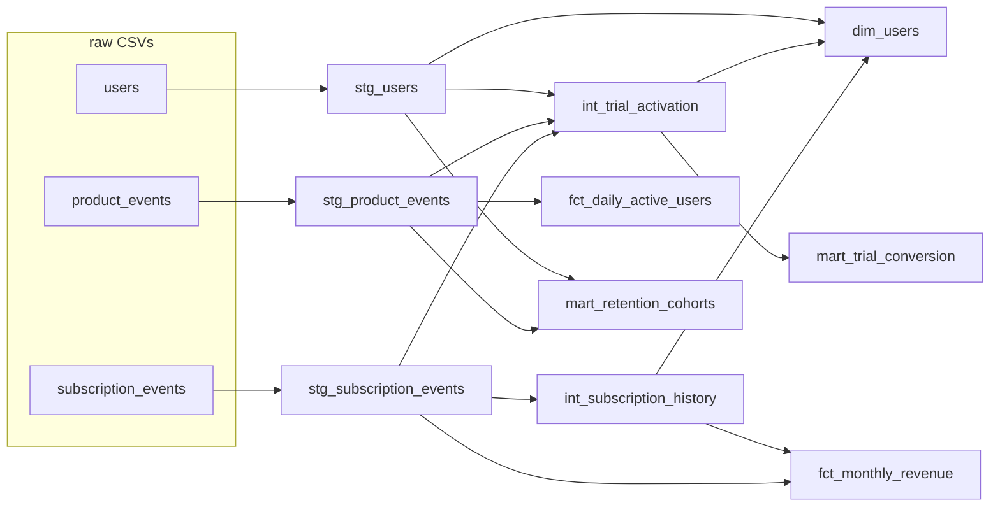

# Subscription Analytics Pipeline (dbt)

A dbt Core project that turns raw SaaS exports (signups, subscription events and product events)
into tested reporting tables: daily active users, month-end MRR, retention cohorts and
trial-to-paid conversion. It runs on DuckDB, so cloning the repo and running `dbt build` takes
about two minutes and needs no account.

The source data is synthetic, generated by a seeded script that deliberately injects the problems
a real pipeline has to handle: duplicate events, late-arriving events, and a UTC/IST time-zone split.

## Lineage



| Layer | Materialization | Models |
|---|---|---|
| Staging | view | `stg_users`, `stg_subscription_events`, `stg_product_events` |
| Intermediate | view | `int_subscription_history` (Type 2), `int_trial_activation` |
| Marts | table / incremental | `dim_users`, `fct_daily_active_users` (incremental), `fct_monthly_revenue`, `mart_retention_cohorts`, `mart_trial_conversion` |

## Run it

```bash
python -m venv .venv && source .venv/bin/activate
pip install -r requirements.txt
python scripts/generate_data.py
dbt build --profiles-dir .
```

Run `dbt build` a second time to exercise the incremental path. CI runs both builds on every push.

## What a run produces

From the seeded dataset (`SEED = 42`):

| Check | Result |
|---|---|
| Raw product events | 297,999 rows, 295,049 distinct after deduplication (2,950 re-sends removed) |
| Late-arriving events (ingested over a day after they happened) | 8,936 |
| Signups on a different calendar day in IST than in UTC | 1,152 of 5,000 (23.0%) |
| Trial conversion, activated vs not activated | 32.8% vs 13.1% |
| Models / data tests | 10 models, 42 tests, all passing on both full and incremental runs |

## Design decisions

**Report in IST, store in UTC.** Raw timestamps stay in UTC; every reporting date, week and month is
computed in IST through the `to_ist` and `ist_week_start` macros. IST has no daylight saving, so a
fixed +5:30 offset is exact. Bucketing by UTC date would put 23% of signups on the wrong day.
`assert_late_utc_signups_roll_to_next_ist_day` re-derives the expected IST date independently and
fails if that bug comes back.

**Deduplicate in staging.** Clients re-send some events with the same `event_id`.
`stg_product_events` keeps the first ingested copy with `row_number()`, and a `unique` test on
`event_id` proves it.

**Incremental with a lookback, proved by reconciliation.** `fct_daily_active_users` is incremental
with `delete+insert` on the date key. Each run recomputes the last `late_arrival_days` (default 3)
days already in the table, so late events still land on the day they happened.
`assert_daily_active_users_reconcile_to_staging` compares the incremental table with a full
recompute, day by day, and fails on any mismatch.

**Type 2 history from an event log.** `int_subscription_history` derives one row per subscription
state with `LEAD()`, giving `valid_from` / `valid_to` windows. The custom `no_overlapping_windows`
test and `assert_one_current_version_per_user` keep the history consistent, and
`fct_monthly_revenue` reads month-end MRR from it.

**Portable SQL.** Date logic goes through dbt's cross-database macros (`dateadd`, `datediff`,
`date_trunc`, `date_spine`, `hash`) instead of DuckDB-specific functions.

## Running on Databricks

Not tested. The models avoid DuckDB-specific SQL, so the main changes would be: load the three CSVs
as Delta tables and point the `raw` source at them instead of `external_location`, then add a
`dbt-databricks` target to `profiles.yml`.

## Layout

```
scripts/generate_data.py   seeded synthetic data with injected duplicates, late events and the UTC/IST split
models/staging/            sources, light cleaning, deduplication, IST dates
models/intermediate/       Type 2 subscription history, trial activation
models/marts/              dimensions, facts and cohort marts
macros/                    to_ist, ist_week_start
tests/generic/             not_negative, unique_combination, no_overlapping_windows
tests/                     singular tests: time zone, reconciliation, Type 2 integrity, rate bounds
```
